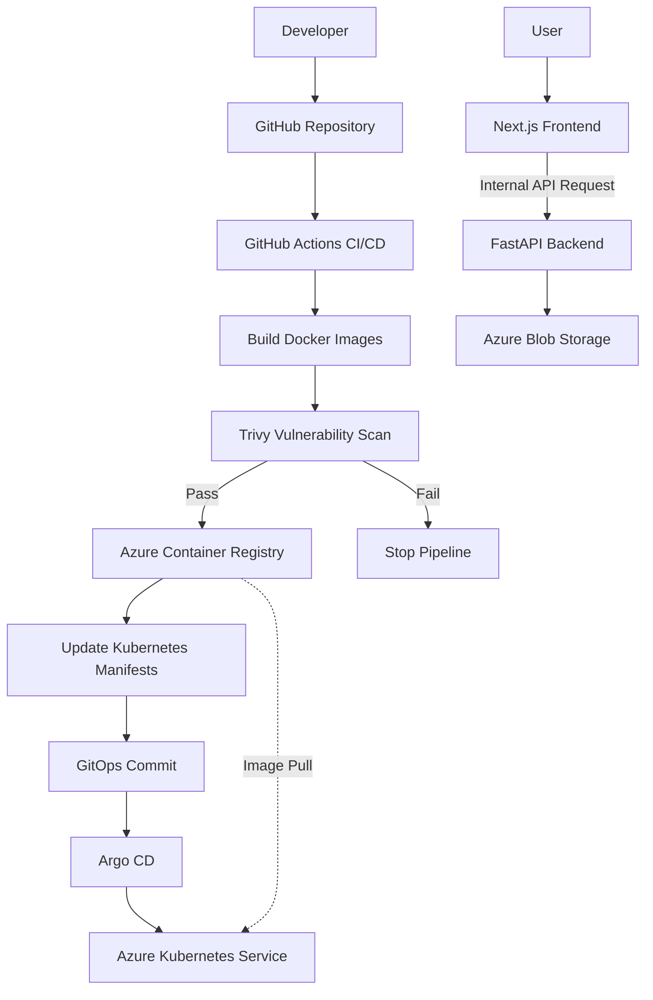

# Cloud-Native QR Code Generator

A cloud-native QR code generator built with Next.js, FastAPI, Docker, Kubernetes, and Microsoft Azure. This project demonstrates a secure, automated DevOps workflow using Infrastructure as Code (IaC), CI/CD, DevSecOps, and GitOps.

The application generates QR codes and stores them in Azure Blob Storage. The primary focus is on building a repeatable, secure, and maintainable deployment pipeline.

## Architecture & Workflow

The project follows a GitOps-based deployment workflow to automate application delivery and maintain a declarative Kubernetes environment.

1. **Code Push:** A developer pushes application changes to the `main` branch on GitHub.
2. **CI/CD Pipeline:** GitHub Actions builds the frontend and backend Docker images.
3. **Security Scanning:** Trivy scans the container images for vulnerabilities. The pipeline is configured to block images that violate the defined security policy.
4. **Container Registry:** Images that pass the security gate are pushed to a private Azure Container Registry (ACR).
5. **Manifest Update:** The pipeline updates the Kubernetes manifests with the new image tags and commits the changes to GitHub.
6. **GitOps Synchronization:** Argo CD detects changes in the `k8s/` directory and synchronizes the desired application state with Azure Kubernetes Service (AKS).
7. **Application Routing:** Users access the Next.js frontend through the configured public entry point. The frontend proxies API requests to the FastAPI backend through Kubernetes DNS.
8. **QR Code Generation:** The FastAPI backend generates QR codes and uploads them to Azure Blob Storage.

> **Note:** The backend is designed to remain internal to the Kubernetes cluster through a `ClusterIP` Service. The frontend's public access, HTTPS configuration, and ingress implementation depend on the deployed networking configuration.

## Architecture Diagram

The following diagram illustrates the intended application and deployment workflow.



## Key DevOps & DevSecOps Practices

### 1. Zero-Trust Networking

- The FastAPI backend uses a Kubernetes `ClusterIP` Service to avoid direct public exposure.
- The Next.js frontend acts as a Backend-for-Frontend (BFF), proxying requests to the backend through Kubernetes DNS.
- The architecture avoids exposing the backend through a separate public endpoint.
- Network policies, identity permissions, and ingress restrictions should be configured to enforce least-privilege access.

### 2. Infrastructure as Code (IaC)

Terraform provisions and manages the Azure infrastructure, including:

- Azure Resource Group
- Azure Kubernetes Service (AKS)
- Azure Container Registry (ACR)
- Azure Storage Account and Blob Storage resources

Infrastructure changes can be reviewed through Terraform plans and tracked in version control.

### 3. GitOps with Argo CD

- Kubernetes manifests are stored in the GitHub repository.
- Argo CD monitors the configured Git repository and reconciles the cluster with the declared configuration.
- Automatic synchronization reduces the need for manual `kubectl apply` commands during routine deployments.
- Git history provides a record of configuration changes.

### 4. Shift-Left Security

- Trivy scans container images for HIGH and CRITICAL vulnerabilities.
- The CI/CD pipeline should fail when an image violates the configured vulnerability policy.
- Image scanning occurs before images are published to ACR.
- Immutable image tags, such as Git commit SHAs, help identify the exact version deployed.

### 5. Secret Management

- GitHub Actions secrets store sensitive CI/CD credentials.
- Kubernetes Secrets can supply application configuration to containers.
- Sensitive credentials must never be committed to the repository.
- For stronger Azure integration, Azure Key Vault and Microsoft Entra Workload ID can be used to reduce reliance on long-lived credentials.

### 6. Observability

The deployment should provide visibility into application and infrastructure health through:

- Kubernetes pod and deployment status
- Container logs
- Resource utilization and cluster metrics
- Application health checks
- Deployment and synchronization status in Argo CD

Azure Monitor with Container Insights is a suitable option for centralized AKS monitoring. A maintained Kubernetes dashboard can also be used when a graphical interface is needed.

### 7. Cost Management

- Terraform enables repeatable infrastructure provisioning and teardown.
- Non-production environments can be created for testing and removed when no longer required.
- Azure resource usage and estimated costs should be reviewed regularly.
- Persistent data, resources created outside Terraform, and retained resources may require separate cleanup.

**Important:** AKS, networking, storage, container registry, and monitoring resources can incur charges. Review the Azure pricing model before provisioning the environment.

## Technology Stack

| Category | Technologies |
|---|---|
| Cloud Provider | Microsoft Azure |
| Infrastructure as Code | Terraform |
| Container Orchestration | Azure Kubernetes Service (AKS) |
| Container Registry | Azure Container Registry (ACR) |
| GitOps | Argo CD |
| CI/CD | GitHub Actions |
| Security Scanning | Trivy |
| Frontend | Next.js, React |
| Backend | Python, FastAPI |
| Cloud Storage | Azure Blob Storage |
| Containerization | Docker |
| Monitoring | Azure Monitor / Container Insights (if configured) |

## Repository Structure

```text
devops-qr-code/
├── .github/
│   └── workflows/          # GitHub Actions workflows
├── api/                    # FastAPI backend
├── front-end-nextjs/       # Next.js frontend
├── k8s/                    # Kubernetes manifests
├── terraform/              # Terraform infrastructure code
└── README.md
```

## Prerequisites

Before deploying the project, install and configure the following tools:

- [Microsoft Azure account](https://azure.microsoft.com/)
- [Azure CLI](https://learn.microsoft.com/en-us/cli/azure/install-azure-cli)
- [Terraform](https://developer.hashicorp.com/terraform/install)
- [kubectl](https://kubernetes.io/docs/tasks/tools/)
- [Docker](https://docs.docker.com/get-docker/)
- [Git](https://git-scm.com/downloads)
- [GitHub account](https://github.com/)
- [Argo CD documentation](https://argo-cd.readthedocs.io/en/stable/)

You will also need appropriate Azure permissions to provision the required resources and configure AKS and ACR access.

## Configuration

### 1. GitHub Actions Secrets

Configure the secrets required by your actual workflow under:

**GitHub Repository → Settings → Secrets and variables → Actions**

Depending on your authentication setup, these may include:

- Azure authentication credentials or workload identity federation configuration
- Azure subscription and tenant identifiers
- Azure Container Registry details
- Git credentials for updating manifests, if required
- Other application configuration values

Use only the credentials required by your workflow. Prefer short-lived, federated authentication over long-lived service principal secrets where supported.

### 2. Terraform Variables

Review the Terraform configuration and provide the required variable values. Use a `terraform.tfvars` file locally if appropriate, but do not commit sensitive values to Git.

Consider providing a `terraform.tfvars.example` file containing placeholder values to help other developers configure the project.

### 3. Application Secrets

Configure the backend's Azure Storage authentication using the method implemented by your application.

If the backend uses an Azure Storage connection string, inject it through a protected secret mechanism. Do not place real connection strings in source files or Kubernetes manifests committed to Git.

## Deployment Guide

### Step 1: Authenticate with Azure

```bash
az login
az account set --subscription "<YOUR_SUBSCRIPTION_ID>"
```

Verify that the correct Azure subscription is selected before provisioning resources.

### Step 2: Provision the Infrastructure

Navigate to the Terraform directory:

```bash
cd terraform
terraform init
terraform validate
terraform plan
terraform apply
```

Review the execution plan before approving the deployment.

Confirm that the resulting resource names match the names used in the remaining steps. The examples below assume:

- Resource Group: `qr-devops-rg`
- AKS Cluster: `qr-aks-cluster`

Update these values if your Terraform configuration uses different names.

### Step 3: Connect to AKS

```bash
az aks get-credentials \
  --resource-group qr-devops-rg \
  --name qr-aks-cluster
```

Verify cluster connectivity:

```bash
kubectl get nodes
```

Use the least-privileged Kubernetes access appropriate for your environment. Avoid using administrative credentials unnecessarily.

### Step 4: Install Argo CD

Create the Argo CD namespace:

```bash
kubectl create namespace argocd
```

Install Argo CD using its official installation manifest:

```bash
kubectl apply --server-side --force-conflicts \
  -n argocd \
  -f https://raw.githubusercontent.com/argoproj/argo-cd/stable/manifests/install.yaml
```

For production use, review the installation version, access controls, repository credentials, and network security configuration before deploying.

### Step 5: Access the Argo CD UI

Forward the Argo CD server port to your local machine:

```bash
kubectl port-forward svc/argocd-server \
  -n argocd 8080:443
```

Open the following address in your browser:

```text
https://localhost:8080
```

Configure repository access using an appropriately scoped Git credential or deploy key. Do not store repository tokens in the project source code.

### Step 6: Configure Application Secrets

If the backend requires an Azure Storage connection string, create the Kubernetes Secret using a securely supplied environment variable:

```bash
kubectl create secret generic azure-secrets \
  --from-literal=AZURE_STORAGE_CONNECTION_STRING="$AZURE_STORAGE_CONNECTION_STRING" \
  --dry-run=client -o yaml | kubectl apply -f -
```

Set `AZURE_STORAGE_CONNECTION_STRING` securely before running the command.

Ensure that the backend Deployment references the Secret through its container environment configuration. Creating a Secret alone does not inject it into the application.

For production environments, consider Azure Key Vault with Microsoft Entra Workload ID instead of a long-lived storage connection string.

### Step 7: Configure the Argo CD Application

Create or update the Argo CD Application configuration with the following settings:

- **Repository URL:** Your GitHub repository URL
- **Target Revision:** `main`, or your chosen deployment branch
- **Path:** `k8s`
- **Destination:** Your AKS cluster
- **Namespace:** The namespace used by your application
- **Sync Policy:** Automatic synchronization, if desired

Ensure the Kubernetes manifests reference the correct ACR image names and tags, and that AKS has permission to pull the images.

### Step 8: Trigger the CI/CD Pipeline

Push a change to the configured branch:

```bash
git add .
git commit -m "Update application"
git push origin main
```

The intended pipeline should:

1. Build the frontend and backend images.
2. Scan images with Trivy.
3. Stop if the configured security policy is violated.
4. Push approved images to ACR.
5. Update the Kubernetes image tags in Git.
6. Allow Argo CD to synchronize the updated manifests to AKS.

Ensure that automated manifest commits do not unintentionally trigger an endless sequence of builds.

## Verification & Testing

After deployment, verify the health of the cluster and application.

### Check Kubernetes Resources

```bash
kubectl get nodes
kubectl get pods -A
kubectl get services -A
kubectl get deployments -A
```

Check the application namespace and review logs if a workload is not healthy:

```bash
kubectl logs deployment/<BACKEND_DEPLOYMENT_NAME> \
  -n <APPLICATION_NAMESPACE>
```

Replace the placeholders with the actual deployment and namespace names.

### Check Argo CD Synchronization

Verify that the Argo CD Application reports the expected synchronization and health status.

If synchronization fails, inspect the Application details, repository configuration, image references, and Kubernetes events.

### Test Application Functionality

- Open the configured frontend URL.
- Submit text or a URL to generate a QR code.
- Confirm that the generated QR code is displayed or returned correctly.
- Verify that the backend successfully uploads the QR code to Azure Blob Storage.
- Confirm that the frontend can reach the backend through Kubernetes DNS.
- Confirm that the backend has no unintended public endpoint.
- Review the GitHub Actions workflow and confirm that the Trivy security gate behaves as expected.

## Troubleshooting

| Problem | What to check |
|---|---|
| Terraform deployment fails | Azure permissions, subscription, variable values, resource names, and quotas |
| AKS connection fails | Cluster status, credentials, Azure permissions, and network access |
| Pods remain in `Pending` | Available cluster capacity, resource requests, and scheduling events |
| Pods enter `ImagePullBackOff` | ACR image name, tag, registry permissions, and network connectivity |
| Argo CD fails to synchronize | Repository URL, credentials, manifest validity, destination namespace, and image references |
| Frontend cannot reach backend | Kubernetes Service name, port, namespace, DNS, and network policies |
| QR code upload fails | Storage authentication, container name, permissions, and backend logs |
| GitHub Actions fails | Workflow configuration, required secrets, permissions, and scan results |

Useful diagnostic commands:

```bash
kubectl get events -A --sort-by=.metadata.creationTimestamp
kubectl describe pod <POD_NAME> -n <APPLICATION_NAMESPACE>
kubectl logs <POD_NAME> -n <APPLICATION_NAMESPACE>
```

## Cost Management & Cleanup

To remove infrastructure managed by Terraform when it is no longer needed:

```bash
cd terraform
terraform plan -destroy
terraform destroy
```

Review the planned destruction before confirming it.

**Warning:** Destroying infrastructure can permanently remove resources and data. Back up any QR codes or other data you need to retain. Verify whether storage data, persistent resources, public IP addresses, monitoring resources, and resources created outside Terraform require separate cleanup.

Do not run `terraform destroy` against a shared or production environment without authorization and a reviewed cleanup plan.

## Future Improvements

Potential enhancements include:

- Integrating Azure Key Vault and Microsoft Entra Workload ID.
- Adding automated unit, integration, and end-to-end tests.
- Implementing dependency and infrastructure security scanning.
- Adding Azure Monitor dashboards, alerts, and centralized logging.
- Configuring HTTPS, managed certificates, DNS, and a secure ingress solution.
- Implementing network policies and more restrictive workload permissions.
- Adding deployment rollback procedures and release approvals.
- Using separate development, staging, and production environments.
- Adding automated cost monitoring and budget alerts.

## License

Add a license file if you intend to distribute or allow others to reuse this project. For example, you can create a `LICENSE` file containing the terms of your chosen open-source license.
